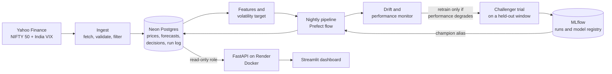

<div align="center">

# VolWatch

**A self-monitoring forecasting pipeline for next-session NIFTY 50 volatility**

[](https://github.com/Tush2602/VolWatch/actions/workflows/ci.yml)


[Live dashboard](https://hbuetb5899qmcggnj9srpe.streamlit.app/) ·
[API docs](https://volwatch-api.onrender.com/docs) ·
[Results](#results) ·
[Let's connect](#lets-connect)

</div>

<!-- Add a screenshot: save it as docs/dashboard.png, then remove this comment markers:

-->

> **A technical forecasting demonstration.** It forecasts *volatility* (how large price swings are), not prices.
> It is not investment advice and makes no trading or profit claims.

## In short

- Forecasts the **next trading session's volatility** for the NIFTY 50, in annualized percent (the same units as India VIX).
- Compares persistence, EWMA, GARCH, XGBoost, and an LSTM against a rescaled **India VIX** benchmark on a sealed 2020–2026 test set.
- **Honest result:** the deployed XGBoost model clearly beats naive baselines and roughly *ties* the VIX benchmark. It does not beat it.
- Tested six retraining strategies on 14 years of replayed history. Feature-drift retraining did not help, so the deployed policy
  retrains only when performance degrades.
- Runs as a real system: validated data ingestion, Postgres storage, experiment tracking and a model registry, a Prefect nightly
  flow, a Dockerized API, a dashboard, 94 automated tests, and CI.

## Why this project

Most ML projects stop at a score in a notebook. VolWatch covers the rest of the lifecycle: sourcing and validating live data,
comparing models fairly, tracking experiments, deciding *when* retraining is actually warranted, deploying a service, and
showing the limits honestly. Every design choice has a reason, and the README records the ones that didn't work out.

## Architecture



| Layer | What it does | Folder |
|---|---|---|
| Ingest | Retrying downloads, row validation, a filter that drops unfinished same-day bars, verified idempotent loads | `ingest/` |
| Storage | Neon Postgres behind a single `Database` class | `db/` |
| Features | Volatility estimator and a leakage-tested feature builder | `features/` |
| Models | Baselines, GARCH, XGBoost, LSTM, time splitter, metrics (RMSE, MAE, QLIKE) | `models/` |
| Tracking | MLflow experiment tracker and model registry with a `champion` alias | `tracking/` |
| Monitoring | Drift detectors, retrain policy, historical policy replay | `monitoring/` |
| Pipeline | Nightly steps, challenger trial, retrainer | `pipeline/` |
| Orchestration | Prefect flow with retries and run records | `flows/` |
| Serving | FastAPI service that reads stored forecasts | `api/` |
| UI | Streamlit dashboard | `dashboard/` |

## What it forecasts

The target is each day's volatility, estimated from the day's high and low (the Parkinson range estimator), annualized and
expressed in percent. Volatility clusters, so it is forecastable in a way that prices are not. The estimate is a *proxy*:
it ignores overnight gaps, so it reads lower than close-to-close measures. Across the history I checked, it correlates about
0.71 with India VIX.

Features (all known at the close of day *t*): that day's volatility, its 1-, 2-, and 5-day lags, 5- and 22-day rolling means,
absolute return, India VIX, and the VIX change. The label is the next trading day's volatility.

## Results

Scored **once**, on a sealed test set: 2020-01-01 to 2026-10-14 (1,679 trading days, including the COVID crash). Training ended
in 2017, settings were chosen on a separate 2018–2019 validation period, and the training, validation, and test windows are
separated by a purge so labels cannot cross a boundary. Lower is better.

| Model | RMSE | MAE | QLIKE |
|---|---|---|---|
| Persistence (tomorrow = today) | 7.632 | 4.485 | 0.795 |
| EWMA (0.94) | 7.203 | 4.361 | 0.460 |
| GARCH(1,1), rescaled | 7.151 | 4.407 | 0.427 |
| LSTM (5-seed average) | 6.750 | 3.766 | 0.420 |
| **XGBoost (deployed)** | 6.473 | **3.707** | 0.408 |
| India VIX, rescaled (benchmark) | **6.427** | 3.872 | **0.386** |

QLIKE is the main metric because it penalizes under-forecasting volatility more than over-forecasting it.

**How to read this honestly**

- Learned models clearly beat the naive baselines: XGBoost's RMSE is about 15% below persistence.
- XGBoost **ties** the rescaled VIX benchmark on RMSE (within 1%) and beats it on MAE, but is about 6% worse on QLIKE.
  VIX carries information from the options market that price history alone does not.
- The LSTM trails XGBoost. With roughly 2,900 daily rows, the simpler tree model was at least as good, and the LSTM's gap came
  mostly from the 2020 crash window.
- A model that looked about 5% better than VIX on the validation period came out about 6% *worse* on the test period.
  That is why the test set is sealed and the settings were frozen before it was touched.
- The dashboard's 30-day backtest shows the deployed model running below realized volatility as volatility rose, which is the
  expected lag for a model trained only through 2019.

## Retraining: tested, not assumed

A plain KS drift test at p < 0.05 fires almost constantly on correlated daily features. Instead of assuming retraining helps, I
replayed about 14 years of history (with labels delayed one day) and compared six strategies: never retrain, a quarterly
schedule, two feature-drift variants, performance-triggered, and both signals together.

- From 2018 onward, every strategy scored within about 1% on QLIKE (0.404 to 0.408). Retraining did not measurably improve accuracy.
- Feature-drift retraining was *worse* than never retraining in the 2012–2017 calibration period (QLIKE 0.608 vs 0.568).
- Performance-triggered retraining was the only strategy never worse than doing nothing (0.536 in calibration).
- **Deployed policy:** retrain only when the champion's recent QLIKE exceeds 1.35 times the benchmark's, with a 20-day cooldown.
  Feature drift is shown as a warning and does not trigger retraining.
- A challenger must beat the champion by 2% on the same recent 60-day window to be promoted. A forced trial on current data
  came out essentially tied (0.3605 vs 0.3593), so the champion stayed.

## Engineering practices

- **Data quality:** retries with backoff, row-level validation, a filter that drops unfinished same-day bars, and verified,
  repeat-safe loads.
- **Leakage controls:** features use only past data (a test changes future rows and asserts nothing earlier moves), and time
  splits are purged at the boundaries.
- **Experiment tracking:** every run is logged in MLflow with a Postgres backend, and a model registry with a `champion` alias.
- **Orchestration:** a Prefect flow with retries on the data pull. Every run is recorded, failed runs are recorded too, and
  stored error text is scrubbed of connection strings.
- **Serving:** the API reads stored forecasts through a **read-only** database role, flags stale forecasts, and reports
  pipeline health. Backtest rows are labeled `backfill` and are never returned by `/predict`.
- **Failure behavior:** stale or failed data stops the pipeline before it writes a forecast. The API answers a generic 503
  and never echoes error details.
- **Tests:** 94 automated tests, all offline (no network, no database), run in CI on every push.

## API

Base URL: `https://volwatch-api.onrender.com` (interactive docs at `/docs`).

| Endpoint | Returns |
|---|---|
| `GET /predict` | The latest live forecast, its age, a `stale` flag, and the model version |
| `GET /history?limit=30` | Past forecasts next to the volatility that actually followed, labeled `live` or `backfill` |
| `GET /status` | Pipeline health, champion version, last retrain decision, drift warning |
| `GET /health` | Liveness check, with no database call |

```bash
curl https://volwatch-api.onrender.com/predict
```

Example response shape (values illustrative):

```json
{
  "ticker": "^NSEI",
  "as_of_date": "2026-10-30",
  "forecast_vol": 10.568,
  "model_version": 1,
  "source": "live",
  "age_days": 1,
  "stale": false,
  "note": "Forecast of the next trading session's range-based volatility (annualized %). A technical forecasting demo, not investment advice."
}
```

## Decisions worth knowing

- **Volatility, not price.** Prices are close to unpredictable. Volatility clusters, so it is a defensible target.
- **Serve stored forecasts.** The target changes once a day, so the API reads the nightly result instead of loading a model on
  every request. It needs no model files and cannot drift out of sync with the champion.
- **Read-only database role** for the public API, so a leaked credential can read forecasts and nothing else.
- **Honest labeling.** Backtest forecasts are marked as backfilled everywhere. They are never presented as live.

## Repository layout

```
api/          FastAPI service and ForecastService
dashboard/    Streamlit app, API client, charts
db/           Postgres schema and Database class
features/     VolatilityEstimator and FeatureBuilder
flows/        Prefect nightly flow
ingest/       fetch, validate, filter, backfill
models/       baselines, GARCH, XGBoost, LSTM, splitter, metrics
monitoring/   drift detection, retrain policy, replay
pipeline/     nightly steps, challenger trial, retrainer
tracking/     MLflow tracker and model registry
tests/        94 offline tests
```

## Run it locally

```bash
git clone https://github.com/Tush2602/VolWatch.git
cd VolWatch
uv sync
```

Copy `.env.example` to `.env` and fill in `DATABASE_URL` (Postgres) and `MLFLOW_TRACKING_URI` (a separate Postgres database).

```bash
uv run python -m db.check_connection        # apply the schema
uv run python -m ingest.backfill            # load history
uv run python -m models.run_final_test      # reproduce the comparison table
uv run python -m flows.nightly              # run the nightly pipeline once
uv run uvicorn api.main:app --port 8000     # serve the API
uv run streamlit run dashboard/app.py       # open the dashboard
uv run python -m pytest -q                  # run the tests
```

## Honest scope (v1)

- NIFTY 50 only, with a one-day horizon.
- The nightly job currently runs from a local machine and is not hosted. Hosting it needs the champion model files in remote
  storage, which is listed under future work.
- The free API host sleeps when idle, so the first request after a quiet period can take up to about a minute. The dashboard
  shows a waking-up message and retries.
- Volatility is a range-based proxy, not a directly observed quantity.
- The deployed model was trained through 2019. Retraining did not measurably improve it in my tests, but that result is from
  one market and one target.

## Future work

- Run the nightly flow on a hosted scheduler, with model files in remote object storage.
- More indices and a two-to-three-day horizon.
- Refit a promoted challenger on its holdout window, validated separately.

## Tech stack

Python · pandas · NumPy · SciPy · XGBoost · PyTorch · arch (GARCH) · MLflow · Prefect · FastAPI · Docker · Postgres (Neon) ·
Streamlit · Plotly · pytest · GitHub Actions · uv

## About me

Hi, I'm **Tushar Joshi**. I'm from **Haldwani, Uttarakhand**, and I'm studying **B.Tech in Electrical Engineering with a
Minor in Artificial Intelligence** at **Punjab Engineering College (Deemed to be University), Chandigarh** (2024–2028).
I'm a Reliance Foundation Undergraduate Scholar.

I build machine-learning systems end to end: data pipelines, models, deployment, and monitoring. VolWatch is my most
complete project so far. Before it, I built a hybrid movie recommender (CineMate V2) and a churn-prediction pipeline with
automated drift monitoring. Right now I'm looking to apply this kind of work to real problems, and to learn from people who
run ML systems in production.

## Let's connect

If you have feedback, ideas, a question about any design decision here, or an opportunity you think I'd be a fit for,
I'd like to hear from you.

| | |
|---|---|
| LinkedIn | [linkedin.com/in/tushar-joshi-47a5a9311](https://www.linkedin.com/in/tushar-joshi-47a5a9311) |
| GitHub | [github.com/Tush2602](https://github.com/Tush2602) |
| Email | [tush2602@gmail.com](mailto:tush2602@gmail.com) |
| Phone | [+91 90680 04046](tel:+919068004046) |

---

If you like this project, **please give it a ⭐ on GitHub**. It genuinely helps, and it tells me the work is useful to someone.
And if something here sparked a thought, don't keep it to yourself: let's connect on LinkedIn or GitHub, or write to me by
email or phone.

## License

MIT. See [LICENSE](LICENSE).